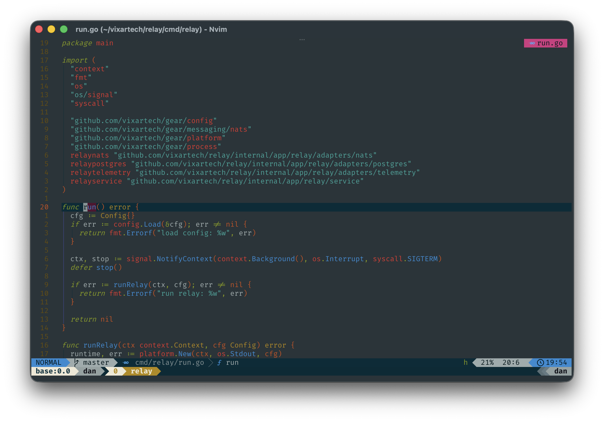

# Dotfiles


A terminal workspace built around neovim and lazyvim, with solarized colors
and a transparent ghostty window. Includes fish, tmux, git and lazygit
configs for macos and linux.



Highly inspired by [craftzdog's dotfiles](https://github.com/craftzdog/dotfiles).

## Install

### Prepare

Install the build tools for your system:

#### Macos

```sh
xcode-select --install
```

Wait for the installation to finish before continuing.

#### Linux

On ubuntu or debian:

```sh
sudo apt-get update
sudo apt-get install build-essential procps curl file git
```

For other distributions, follow the [build tool instructions](https://docs.brew.sh/Homebrew-on-Linux#requirements).

Install ghostty and the fira code font separately; the brewfile installs them only on macos.

#### Homebrew

Install [homebrew](https://docs.brew.sh/Installation) if needed, then follow
the installer's next steps to add it to your shell. Check that `brew --version` works.

### Clone

```sh
git clone https://github.com/dmironenko/.dotfiles.git ~/.dotfiles
cd ~/.dotfiles
```

Before installing, back up any existing configs and set your name and email
in `git/.gitconfig`. The installer links these files into your home directory.

Check `Brewfile` for the full package list. It includes development tools
such as go, rust, postgresql and redis alongside the terminal apps.

### Install configs

Run as your regular user:

```sh
make install
```

This installs the brewfile dependencies, links the configs with gnu stow
and sets fish as your login shell. Neovim 0.12+ is required and is included
among the dependencies.

The commands `sudo` and `chsh` may ask for a password.

<details>
<summary>If stow reports a conflict</summary>

An existing file is blocking a config link. Back up the file shown in the error,
move it out of the way and run `make install` again.

</details>

### First launch

Open ghostty. Fish automatically opens a tmux session; this is expected.

Run `nvim` and wait for the plugins and tools to finish installing.

You should see the editor shown in the screenshot above. Run `:checkhealth`
inside neovim to check for missing tools or setup issues.

## Update

From the repo directory, pull the latest changes and relink the configs:

```sh
git pull
make sync
```

Use `make sync-nvim` to link just the neovim config. If the brewfile changed,
run `make install` to install the dependencies too.

Fish and tmux load plugin changes on startup.

<details>
<summary>Neovim plugin versions</summary>

After pulling neovim plugin changes, run `:Lazy restore` to use the locked versions.

To upgrade plugins yourself, run `:Lazy update` and commit
`nvim/.config/nvim/lazy-lock.json`.

</details>

## Local settings

Keep secrets and local fish settings in `~/.config/fish/config-local.fish`,
and private functions in `~/.config/fish/functions/`.
Runtime state stays outside version control.

<details>
<summary>Work identity for git</summary>

To use a separate name and email for work repositories:

```sh
mkdir -p ~/.config/git
cp -i git/examples/gitconfig.local.example ~/.gitconfig.local
cp -i git/examples/work.gitconfig.example ~/.config/git/work.gitconfig
chmod 600 ~/.gitconfig.local ~/.config/git/work.gitconfig
```

Keep any existing local configs. Set your name, email and optional git server
in `~/.config/git/work.gitconfig`. Set your work directory in
`~/.gitconfig.local`; the default is `~/work/`, and the trailing slash is required.

You can add separate includes for other employers or clients.
These local files stay outside the repo and survive `make sync`.

Check the active identity inside a repository:

```sh
git config --show-origin --get user.email
```

</details>
